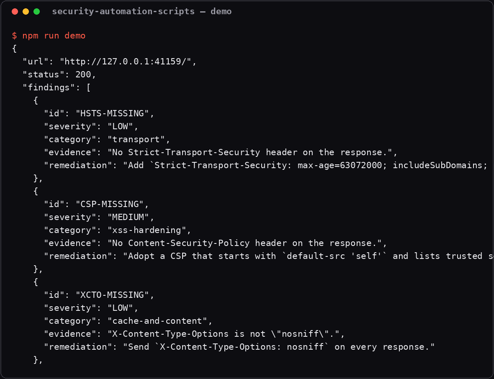

# security-automation-scripts

[](https://github.com/gravion-ux/security-automation-scripts/actions/workflows/ci.yml)



*Demo: the automation checks running locally against sample targets.*

A small, dependency-light toolkit of security automation utilities. Each
module is self-contained, can be imported individually, and is covered
by an automated test suite.

> **Scope statement.** Every script in this repository is read-only.
> None of them send payloads, mutate server state, or perform scans
> beyond the target URL the operator explicitly passes in.

## What's here

| path | purpose |
| --- | --- |
| `src/headers.js`      | HTTP response header analyzer |
| `src/tls.js`          | TLS posture checker (protocol, cipher, cert) |
| `src/log-normalizer.js` | nginx / syslog / JSON line → JSON record |
| `src/cli.js`          | `sec-auto` command-line entry |
| `test/*.test.js`      | automated coverage for every module |

## Quick start

```bash
npm test                 # run the test suite
node src/cli.js demo     # exercise every tool on a local mock server
node src/cli.js headers --url https://your-staging.example.com
node src/cli.js tls     --url https://your-staging.example.com
node src/cli.js log     --in /var/log/nginx/access.log --out normalized.jsonl
```

## The tools

### HTTP header analyzer — `src/headers.js`

A pure function over a response's headers (keys already lowercased): it
makes no network calls itself. The CLI performs a single `GET` and passes
the response headers in. Every check that triggers produces a finding
with a stable id, severity, category, evidence, and remediation:

| id | severity | triggers when |
| --- | --- | --- |
| `HSTS-MISSING` | LOW | no `Strict-Transport-Security` header |
| `CSP-MISSING` | MEDIUM | no `Content-Security-Policy` header |
| `XCTO-MISSING` | LOW | `X-Content-Type-Options` is not `nosniff` |
| `XFO-MISSING` | MEDIUM | no `X-Frame-Options`, and no CSP `frame-ancestors` |
| `REFERRER-POLICY-MISSING` | LOW | no `Referrer-Policy` header |
| `SERVER-VERSION-DISCLOSURE` | INFO | the `Server` header contains a version number |
| `X-POWERED-BY` | INFO | an `X-Powered-By` header is present |

```bash
node src/cli.js headers --url https://your-staging.example.com
```

The `demo` subcommand runs this analyzer against a local mock server
that deliberately returns a bare response. Its actual output:

```json
{
  "url": "http://127.0.0.1:40925/",
  "status": 200,
  "findings": [
    {
      "id": "HSTS-MISSING",
      "severity": "LOW",
      "category": "transport",
      "evidence": "No Strict-Transport-Security header on the response.",
      "remediation": "Add `Strict-Transport-Security: max-age=63072000; includeSubDomains; preload` at the edge."
    },
    {
      "id": "CSP-MISSING",
      "severity": "MEDIUM",
      "category": "xss-hardening",
      "evidence": "No Content-Security-Policy header on the response.",
      "remediation": "Adopt a CSP that starts with `default-src 'self'` and lists trusted sources explicitly."
    },
    {
      "id": "XCTO-MISSING",
      "severity": "LOW",
      "category": "cache-and-content",
      "evidence": "X-Content-Type-Options is not \"nosniff\".",
      "remediation": "Send `X-Content-Type-Options: nosniff` on every response."
    },
    {
      "id": "XFO-MISSING",
      "severity": "MEDIUM",
      "category": "xss-hardening",
      "evidence": "No clickjacking protection (X-Frame-Options or CSP frame-ancestors).",
      "remediation": "Add `X-Frame-Options: DENY` or `Content-Security-Policy: frame-ancestors 'none'`."
    },
    {
      "id": "REFERRER-POLICY-MISSING",
      "severity": "LOW",
      "category": "information-disclosure",
      "evidence": "No Referrer-Policy header on the response.",
      "remediation": "Add `Referrer-Policy: strict-origin-when-cross-origin`."
    },
    {
      "id": "SERVER-VERSION-DISCLOSURE",
      "severity": "INFO",
      "category": "information-disclosure",
      "evidence": "Server header discloses version: Demo/1.0",
      "remediation": "Strip version tokens from the Server header at the edge."
    }
  ]
}
```

(The port is ephemeral — the demo binds a random local port on each
run.)

### TLS posture checker — `src/tls.js`

Performs a single TLS handshake against the host and port derived from
an `https` URL and never sends application data. It reports the
negotiated protocol and cipher plus certificate fields (subject,
issuer, expiry, DNS SANs). The handshake accepts the certificate as
presented so the checker can report on it — including expired or
self-signed certificates — instead of failing the connection. Findings:

| id | severity | triggers when |
| --- | --- | --- |
| `TLS-CONNECT-FAILED` | MEDIUM | the inspection fails, or the URL is not `https` |
| `TLS-DEPRECATED-PROTOCOL` | HIGH | TLSv1, TLSv1.1, or SSLv3 is negotiated |
| `TLS-UNKNOWN-PROTOCOL` | MEDIUM | the protocol is neither TLSv1.2/1.3 nor a known deprecated one |
| `TLS-WEAK-CIPHER` | HIGH | the cipher matches RC4, 3DES, NULL, EXPORT, or MD5 |
| `TLS-CERT-EXPIRED` | CRITICAL | the certificate's expiry date has passed |
| `TLS-CERT-EXPIRY-IMMINENT` | HIGH | the certificate expires within 14 days |

```bash
node src/cli.js tls --url https://your-staging.example.com
```

Actual output against a throwaway local HTTPS server with a
self-signed certificate (TLS 1.3, healthy expiry — hence no findings):

```json
{
  "url": "https://localhost:38179/",
  "tls": {
    "ok": true,
    "protocol": "TLSv1.3",
    "cipher": "TLS_AES_256_GCM_SHA384",
    "cert": {
      "subject": "localhost",
      "issuer": "localhost",
      "validTo": "Feb 21 15:28:19 2027 GMT",
      "sans": []
    }
  },
  "findings": []
}
```

### Log normalizer — `src/log-normalizer.js`

A pure function that takes log text and returns one normalized JSON
record per line, auto-detecting the shape of each line in this order:
JSON, nginx / Apache access log, syslog (with `<priority>`), and a
generic fallback (`{ "source": "generic", ... }`) for anything else.
Every record keeps the original line in its `raw` field. There is no
I/O in the module — the CLI reads the file and writes JSONL to stdout,
or to `--out` when given.

```bash
node src/cli.js log --in sample.log
```

Input:

```
203.0.113.7 - - [10/Oct/2025:13:55:36 +0000] "GET /index.html HTTP/1.1" 200 2326
<134>Oct 11 22:14:15 web01 sshd[123]: Accepted password for deploy from 198.51.100.23 port 51234 ssh2
{"ts":"2025-10-11T22:15:01Z","level":"warn","msg":"disk usage above 85%"}
a line that matches no known format
```

Actual output:

```json
{"source":"nginx","ts":"10/Oct/2025:13:55:36 +0000","client_ip":"203.0.113.7","method":"GET","path":"/index.html","protocol":"HTTP/1.1","status":200,"bytes":2326,"raw":"203.0.113.7 - - [10/Oct/2025:13:55:36 +0000] \"GET /index.html HTTP/1.1\" 200 2326"}
{"source":"syslog","priority":134,"ts":"Oct 11 22:14:15","host":"web01","process":"sshd[123]","message":"Accepted password for deploy from 198.51.100.23 port 51234 ssh2","raw":"<134>Oct 11 22:14:15 web01 sshd[123]: Accepted password for deploy from 198.51.100.23 port 51234 ssh2"}
{"source":"json","ts":"2025-10-11T22:15:01Z","level":"warn","msg":"disk usage above 85%","raw":"{\"ts\":\"2025-10-11T22:15:01Z\",\"level\":\"warn\",\"msg\":\"disk usage above 85%\"}"}
{"source":"generic","line":"a line that matches no known format","raw":"a line that matches no known format"}
```

### Command-line entry — `src/cli.js`

All four subcommands are also available by importing the modules
directly (`analyze` from `headers.js`, `inspect` / `findingsFor` from
`tls.js`, `normalize` from `log-normalizer.js`). The CLI exits `0` on
success, `2` on a usage error (unknown command or a missing flag), and
`1` on a fatal error. Its `--help` output:

```
sec-auto — small security automation utilities

Usage:
  sec-auto demo
  sec-auto headers --url <authorized-url>
  sec-auto tls --url <authorized-url>
  sec-auto log --in <file> [--out <file>]
  sec-auto --help

Notes:
  All probes are read-only.
```

## Design choices

- **No external dependencies.** Everything is implemented in
  Node.js standard library.
- **Read-only.** No script writes to the network beyond a single `GET`
  for the header check, a TLS handshake for the TLS check, and local
  file I/O for the log normalizer.
- **Stable, evidence-led findings.** Every finding has a stable id,
  severity, evidence, and remediation. The same input always produces
  the same output.
- **JSON in / JSON out.** Every tool produces a JSON-serializable
  result that's easy to feed into a CI check or a SIEM.

## Security considerations

- The TLS check inspects the metadata Node.js exposes from a
  handshake. It does not benchmark PFS, session resumption, or
  negotiated curves.
- The header check is posture-only. It does not model the business
  impact of any specific missing header on a given application.
- The log normalizer is a coarse first pass. A real parser (e.g. for
  ELB, CloudFront, or a custom application log format) should replace
  it where the format matters.

## License

MIT — see [`LICENSE`](./LICENSE).
